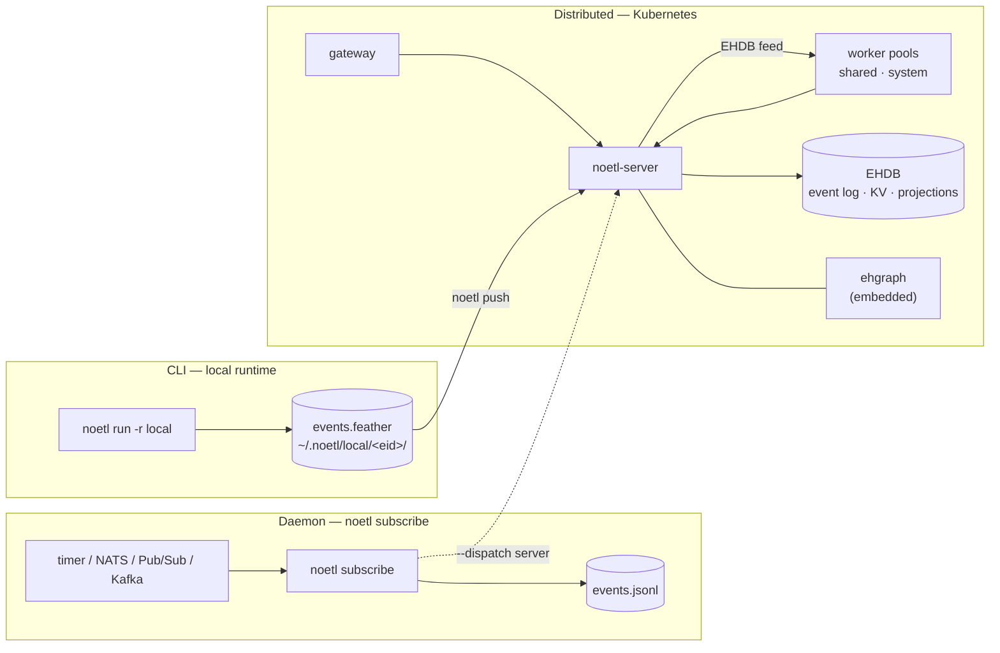
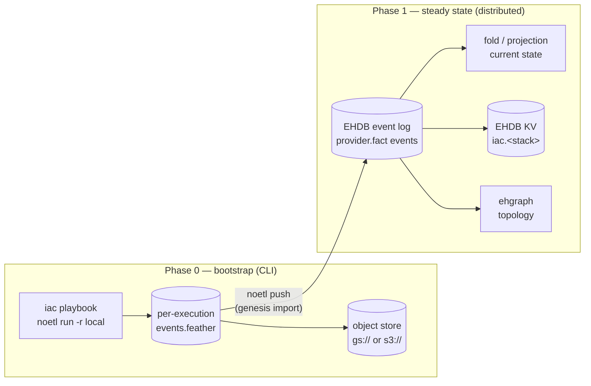

# Deployment Modes

The same playbook runs three ways. They differ in **who runs the control loop**
and **where the events and state land**, not in the DSL. A playbook doesn't
change when it moves from a laptop to a cluster. The runtime does.

| | **CLI** | **Daemon** | **Distributed** |
|---|---|---|---|
| Command | `noetl run -r local` | `noetl subscribe <spec>` | `noetl run -r distributed`, gateway, catalog triggers |
| Code's own term | "local runtime" | "standalone in local mode (no k8s, no server)" | "distributed runtime" / "in-cluster runtime" |
| Control loop | the CLI's in-process Rust interpreter | the same interpreter, re-entered on every trigger | `noetl-server` (orchestrator) + worker pools |
| Lifetime | one execution, then exit | resident, until SIGTERM | long-running services |
| Hosts | one | one | a Kubernetes cluster |
| Writers | one process | one process | one server replica, one EHDB writer per shard |
| Events | optional Feather buffer (`--event-buffer`) | JSONL event log (`--events`) | the EHDB event log |
| Needs a server | no | no (unless `--dispatch server`) | yes |

> **Terminology**
>
> "CLI", "daemon" and "distributed" are this page's names for the three shapes.
> The CLI's help text only distinguishes the **local** and **distributed**
> runtimes (`noetl run --runtime local|distributed|auto`). It calls
> `noetl subscribe` a listener that runs "standalone in local mode". "Daemon" is
> not a CLI term. It describes how that listener is deployed: resident, supervised
> by launchd or systemd.



## CLI: the local runtime

`noetl run` executes a playbook in-process with the CLI's Rust interpreter. It
needs no server, no database and no cluster.

```bash
noetl run playbooks/hello.yaml -r local --set name=world
```

- **Runtime selection.** `-r/--runtime` takes `local`, `distributed` or
  `auto` (the default). An explicit flag wins, then the active context's
  `runtime`, then `local`. Every run prints the runtime it picked, and why, to
  stderr.
- **Local tools.** The local runtime runs a subset of tool kinds. That subset
  includes `shell`, `http`, `playbook`, `duckdb`, `auth` and `sink`.
  Credentials come from the local store (`noetl credential`).
- **Optional event buffer.** With `--event-buffer`, the run records its events
  as an Apache Arrow **Feather V2** file. This is off by default. See
  [The Feather event buffer](#the-feather-event-buffer).

The CLI is also the **bootstrap** phase. The playbooks that stand up NoETL's
own core, EHDB included, can't keep their state in a system that doesn't exist
yet. So the CLI runs them, and their state goes to files on disk. See
[Infrastructure state across the modes](#infrastructure-state-across-the-modes).

### The Feather event buffer

The buffer is the R-1.4 design from the
[blueprint, § H.11](./noetl_global_hybrid_cloud_grid_distributed_architecture_blueprint#h11-local-mode-arrow-feather-batch-buffering-for-events--commands).
It shipped in noetl/cli#102.

- **Layout.** `$NOETL_LOCAL_DIR/<execution_id>/events.feather` plus
  `metadata.json`. The default root is `~/.noetl/local`.
- **Format.** Feather V2 (an Arrow IPC *file*), using the § H.11.3 event
  columns: `event_id`, `execution_id`, `event_type`, `step`, `status`,
  `created_at`, `context`, `result`, `meta`, `parent_event_id`, `payload_ref`.
- **Crash safety.** Each flush writes the whole file to a temp path, fsyncs it,
  and renames it into place. A file on disk is therefore always complete.
- **Lifecycle.** An execution stays `RUNNING` until it is closed. After that it
  is `COMPLETED` or `FAILED`, and immutable.
- **Commands.** `noetl buffer init|append|close|list|cat` manage buffers
  directly. `noetl push` sends closed buffers to a server, oldest first, and
  records `pushed_at` so each one is sent only once.

`noetl push` POSTs the file unchanged to `POST /api/events/batch` with
`Content-Type: application/vnd.apache.arrow.file`, plus the
`X-NoETL-Execution-Id` and `X-NoETL-Event-Count` headers. The server side
shipped in noetl/server#559. It is **off unless
`NOETL_EVENTS_ARROW_INGEST=enabled`**, and returns 501 otherwise. When it is
on, it appends the events to the **EHDB event-log tier only**, tagged
`mirror_source: "local_push"`. It never writes `noetl.event` and never
triggers orchestration, because that server never ran the local execution.

## Daemon: a standalone `noetl subscribe`

`noetl subscribe` runs a `kind: Subscription` spec as one resident process.
Each trigger runs the target playbook through the local runtime, so there's no
Kubernetes and no server.

```yaml
# a timer-driven edge daemon (abridged from qnetmon's deploy/subscribe/edge-mac.yaml)
apiVersion: noetl.io/v2
kind: Subscription
metadata: { name: qnetmon-edge-mac, path: qnetmon/subscribe/edge-mac }
spec:
  source: timer
  every: 60s        # next tick is due 60 s after the previous one fired
  immediate: true   # fire once at startup
  payload: {}       # passed to each run
  dispatch:
    playbook: ../../playbooks/cycle.yaml
```

```bash
noetl subscribe deploy/subscribe/edge-mac.yaml --events var/runs/events.jsonl
```

- **Sources.** `timer` (`every`, `immediate`, `payload`), NATS, Pub/Sub and
  Kafka. Timer support needs CLI 5.4.0 or later.
- **Dispatch.** `--dispatch local` (the default) runs the playbook in-process.
  `--dispatch server` POSTs each trigger to a server's `/api/execute` instead.
  That is the bridge into the distributed mode.
- **Lifetime.** `--max-messages 0` (run continuously) or `--once` (drain once
  and exit). The process stops cleanly on SIGTERM or Ctrl-C.
- **State.** A JSONL event log (`--events`, default `./<name>-events.jsonl`).
  `--spool-dir` gives local-disk store-and-forward.
- **Supervision.** Not the CLI's job. Run it under launchd or systemd with
  restart-on-exit.

The daemon is single-node and single-writer by construction: one process owns
one event log on one host. The CLI has no lock that stops a second
`noetl subscribe` on the same spec, so **run exactly one per spec** and let
the supervisor guarantee it.

**In production.** qnetmon's edge Mac has run this way since 2026-11-07. A
launchd agent (`io.noetl.qnetmon.subscribe`, `KeepAlive`) runs one resident
`noetl subscribe` with a 60 s timer source, and each tick runs one network
monitoring cycle. qnetmon calls this its "Mode A" (local) shape. Its "Mode B"
is the kind cluster.

## Distributed: the clustered control loop

In the distributed mode, the control loop is split across services in a
Kubernetes cluster:

| Component | What it does | How it runs |
|---|---|---|
| **gateway** (Rust) | Auth0 login and session validation. Proxies `/noetl/*` to the server's `/api/*`, scoped per user. Serves SSE and session KV from the EHDB writer. | Deployment |
| **noetl-server** (Rust) | Catalog, credentials, executions and the orchestrator. Publishes commands to the EHDB feed, mirrors events to the event log, serves `/api/ehdb/*` reads. Hosts embedded ehgraph. | StatefulSet, **`replicas: 1`** (a second replica would mint duplicate snowflake ids) |
| **worker pools** (Rust) | Claim commands from the EHDB feed and run the tools. Each worker's pool comes from its feed filter subject. | `shared` (user) pool; `system` pool (orchestration drive, system playbooks, sharded) |
| **noetl-cmdbus-writer** | The EHDB writer: command bus, event bus, KV, SSE and WAL. | StatefulSet, `replicas: 1` |
| **KEDA** | Scales the worker pools on EHDB feed lag (`ehdb_feed_subject_lag`) read from the writer's metrics endpoint. | ScaledObjects |
| **PostgreSQL** | Still the read authority for the catalog and the `noetl.event` projection while EHDB's own projection and catalog log run in shadow. | via pgbouncer |

**Routing to a pool.** An explicit `routing.pool` wins (the subscription
runtime, or the `x-noetl-pool` header). Otherwise the playbook path decides:
`system/…` goes to `system`, `subscription/…` goes to `subscription`, and
everything else goes to `shared`. The orchestration drive itself always runs
on `system`.

**Subscriptions in the cluster.** A `kind: Subscription` registered in the
catalog runs on the `noetl-subscription-runtime` Deployment
(`WORKER_MODE=subscription`, one replica). This is the in-cluster counterpart
of the daemon.

**Single writer, leader election and fencing.** EHDB's ordering guarantee
assumes at most one appender per shard. Today that is guaranteed by
**`replicas: 1`** on the writer and server StatefulSets, not by an election.
The election and fencing machinery exists but is **not authoritative yet**:

- The election is one Kubernetes `coordination.k8s.io/v1` Lease per shard.
  Its fencing epoch is the Lease's `leaseTransitions` counter. The state
  machine is in `ehdb-reference`, and the Kubernetes adapter is in the worker.
  It is **off by default** (`NOETL_EHDB_ELECTION`).
- The fence wraps every durable engine write. Its modes are `Off` (the
  default), `Shadow` and `Enforce`. `Enforce` is owner-gated.
- The server has no leader election of its own.

See ehdb's
[writer-election-and-fencing spec](https://github.com/noetl/ehdb/blob/main/docs/spec/writer-election-and-fencing.md).
Until enforcement is switched on, treat "fenced single writer" as the design
and `replicas: 1` as the mechanism.

For the storage side of this mode (EHDB's engines, the feed, projections and
ehgraph), see [Architecture](/docs/getting-started/architecture).

## Infrastructure state across the modes

NoETL provisions infrastructure with playbooks. Each one has an `action` of
`plan`, `apply`, `verify`, `drift`, `state` or `destroy`, in place of Terraform
or Crossplane. Its state follows the same progression as the runtime. The
decisions are recorded in noetl/ops ADR-0001 to ADR-0007 (see
[Sources](#sources)).



**One record, both phases.** Every resource change is a `ProviderFact`: one per
resource per apply or delete, carried as a `provider.fact` event at
`result.data.provider_fact`. Current state is a deterministic **fold** of those
facts, never a mutable file:

- an applied `ensure` or `adopt` owns a URN;
- a `delete` tombstones it;
- `planned` is intent only.

The fold is the same code in both phases (`fold_facts`).

**Phase 0: bootstrap, CLI-owned.** *Implemented for the kind log-analytics
stack.*

- Each `apply` and each `destroy` opens one buffer execution, appends its
  facts, closes the execution, and copies `events.feather` and
  `metadata.json` to `<state_backup>/<execution_id>/` in object storage.
- State is the facts of every **closed** execution, oldest first. A write
  interrupted before close stays `RUNNING`, and the fold ignores it. This is
  Terraform's state *serials*, kept rather than overwritten.
- The backup copy is done by the IaC playbook (`gsutil` or `aws s3`), not by
  the CLI binary.

**Phase 1: steady state, owned by the control loop.** *Designed. The import
path exists, but the hand-off is not wired.*

- Provisioning runs on the distributed runtime, so its facts land on the
  **EHDB event log** natively.
- Current state is the projection or fold of that log, read the same way as
  `noetl provider --server`.
- An **EHDB KV** bucket (`iac.<stack>`, key = URN) holds the fast
  current-state view. CAS writes give a fenced single writer per stack.
- **ehgraph** holds the topology: resources as nodes, and dependencies and
  ownership as edges.
- The Phase 0 history is imported once with `noetl push` as the genesis
  segment, and archived.

What is still missing before a stack can run with
`state_phase: control-plane` (today the playbook refuses it):

1. Provisioning steps that run on workers: a typed `provider: kubernetes`, or
   a kubectl-capable pool.
2. A KV HTTP surface on the server. The KV engine exists, but there is no
   `/api/` route.
3. The ehgraph topology writer.
4. Both import gates opened on the target cluster: server
   `NOETL_EVENTS_ARROW_INGEST=enabled` and worker
   `NOETL_EHDB_EVENTLOG_MIRROR_SOURCE=server`.

**What stays out of core state.** ClickHouse is a business-data store that
NoETL provisions and feeds, for example qnetmon's network logs. NoETL's own
operational events and state never depend on it (ADR-0004, ADR-0005).

## Choosing a mode

- **CLI.** Use it for development, one-off runs, CI jobs, and bootstrapping the
  platform itself, with `--event-buffer` when you want an auditable,
  pushable record.
- **Daemon.** Use it for one always-on host that reacts to a timer or a
  message source, such as an edge box, a lab machine or a laptop. You accept a
  single node, and the supervisor's restart is your availability story.
- **Distributed.** Use it for multiple tenants, autoscaling, the gateway and
  UI, system playbooks, and the event log as the system of record.

Moving up is additive. The playbook doesn't change. `noetl subscribe
--dispatch server` points a daemon's triggers at a cluster, and `noetl push`
moves a CLI run's history onto the event log.

## Sources

The claims on this page were checked against code on 2026-11-07:
noetl/cli (`src/lib.rs`, `src/local_buffer.rs`, `src/buffer_cli.rs`,
`src/subscribe/`), noetl/server (`handlers/events_arrow.rs`,
`handlers/execute.rs`), noetl/worker (`src/ehdb/lease_store.rs`), noetl/ehdb
(`crates/ehdb-core/src/fence.rs`, `crates/ehdb-reference/src/election.rs`) and
noetl/ops prod manifests.

- **NoETL-as-IaC decisions:** noetl/ops ADR-0001 (playbooks replace
  Terraform/Crossplane), ADR-0002 (two-phase state), ADR-0003
  (desired/observed/drift), ADR-0004 and ADR-0005 (ClickHouse is business data
  only), ADR-0006 (Terraform/Crossplane mapping) and ADR-0007 (Phase 0 is the
  Feather buffer), plus the spec `noetl-iac-log-analytics.md`. These are in
  review in [noetl/ops#361](https://github.com/noetl/ops/pull/361) and will be
  under `docs/decisions/` once it merges.
- **ehgraph:** [Embedding](https://github.com/noetl/ehgraph/blob/main/docs/wiki/Embedding.md)
  (the embedded and standalone modes) and
  [Roadmap](https://github.com/noetl/ehgraph/blob/main/docs/wiki/Roadmap.md)
  (replica and standby stages).
- **EHDB:** [manifest format compatibility](https://github.com/noetl/ehdb/blob/main/docs/spec/manifest-format-compat.md)
  and [writer election and fencing](https://github.com/noetl/ehdb/blob/main/docs/spec/writer-election-and-fencing.md).
